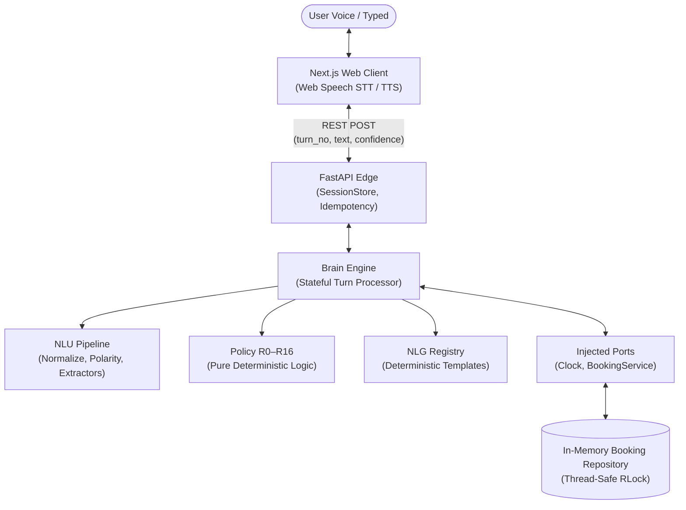

# Architecture & System Design: Bright Smile Dental Voice Assistant

## 1. Use Case & Scope

Bright Smile Dental is an automated telephone appointment line. Real phone callers are unpredictable: they change their minds midway, use ambiguous expressions, experience emergencies, and call to cancel or verify appointments.

### Core Capabilities
- **Book Appointment**: Collects service, date, time (or window preference, or "earliest available"), and patient name. Conducts atomic availability checks, presents alternative slots if booked, validates against clinic hours/lunch, reads back details before commitment, and returns a unique 4-digit confirmation code.
- **Cancel Appointment**: Demands identity verification (exact name + date OR 4-digit code) before disclosing any appointment details. Generates a `CancelProposal` snapshot requiring caller confirmation.
- **Reschedule Handling**: Guided fallback offering cancel-and-rebook or staff callback.
- **Clinic Inquiries**: Answers opening hours (day-aware), service durations, and offered treatments.
- **Emergency Escalation**: Immediate medical warning for severe acute symptoms (uncontrollable bleeding, facial swelling, breathing trouble) with option for immediate callback.
- **Conversation Controls**: Handles silence Reprompts (3-strike ladder), filler recognition (`"um"`, `"let me think"`), hold grace, and explicit human callback routing.

---

## 2. System Architecture

### The "One Big Rule" Compliance
The decision brain is 100% our own deterministic code using only the Python standard library. No LLM (GPT, Claude, Gemini, etc.) or external AI model makes any decision. This invariant is enforced by an automated AST import guard (`backend/tests/test_import_guard.py`).

### Clean Separation of Concerns
1. **Edge Transport**: Plain REST (`/api/sessions` and `/api/sessions/{id}/turns`). Strictly idempotent: replaying a turn returns the cached result without mutating state.
2. **Brain Core**: Accepts `(session, turn_input, ports)` and returns `TurnResult`. Operates on deep copies of the session.
3. **Commit Rule**: Bookings can only be created via `BookingService.book(proposal)`. The service revalidates clinic hours, lead times, horizons, and conflicts under a repository mutex before writing.

---

## 3. State & Dialogue Management

### Phases & Pending States
- **Phases**: `GREETING`, `COLLECTING`, `IDENTIFYING`, `CHOOSING_OPTION`, `CONFIRMING`, `AWAITING_MORE`, `ENDED`.
- **Pending**: Authoritative for bare answers (`"yes"`, `"two"`, `"Sarah"`). States include `INTENT`, `SERVICE`, `DATE`, `TIME`, `NAME`, `VERIFY`, `CONFIRM_YN`, `CANCEL_YN`, `OPTION`, `CHANGE_WHICH`, `HUMAN_YN`, `NOW_YN`.

### The Snapshot Pattern (R13 & R14)
- **`Proposal`**: When all booking slots are validated and available, a frozen `Proposal` snapshot is constructed and read back. The booking is only executed if the subsequent turn is a pure `"yes"`.
- Any slot modification (`"actually make it Saturday"`) instantly destroys the proposal and triggers full re-validation.

---

## 4. Natural Language Understanding (NLU)

1. **Normalization**: Unicode NFKC, curly quote removal, lowercase conversion, written number normalization (`"five thirty"` ➔ `"5 30"`), and punctuation stripping preserving `: , ' - /`.
2. **Clause Splitting & Polarity**: Sentences are segmented on clause boundaries (`"but"`, `"instead"`, punctuation). Negation cues (`"not"`, `"don't"`, `"never"`) assign `NEG` polarity up to 4 tokens ahead within the same clause.
   - Example: *"I don't want a cleaning, I want a checkup"* correctly tags `cleaning` as `NEG` (excluded) and `checkup` as `POS` (selected).
3. **Self-Repair Detection**: Expressions like *"Friday, no wait, Saturday"* identify `"no wait"` as a repair cue, overwriting the slot with `"Saturday"` rather than creating an exclusion.
4. **Whole-Word Matching**: Token boundary regular expressions ensure `"exam"` matches `checkup`, while `"example"` does not.

---

## 5. Clinic Rules & Availability

- **Hours**:
  - Monday–Friday: `09:00`–`13:00` and `14:00`–`17:00` (lunch closure `13:00`–`14:00`).
  - Saturday: `10:00`–`14:00` (no lunch).
  - Sunday: Closed.
- **Services**:
  - Cleaning (30m), Checkup (30m), Filling (60m), Whitening (60m), Extraction (60m), Root Canal (90m).
- **Constraints**:
  - Slot grid: 30 minutes.
  - Booking horizon: 60 days.
  - Minimum lead time: 2 hours.
  - Daylight Saving Time (DST) Handling (T1): The clinic operates in `America/New_York`. All UTC/local conversions pass through `clock.py` (`to_local`, `local_to_utc`). Lead-time elapsed calculations use UTC instants to guarantee precision across the Nov 1, 2026 fall-back transition.

---

## 6. Safety & Verification Design

1. **Cancel Verification (R11)**:
   - A name alone never cancels an appointment. The caller must provide either:
     - 4-digit confirmation code, or
     - Exact full name + appointment date.
   - Close fuzzy matches never disclose details or delete bookings.
   - Generic failure responses prevent appointment probing: *"I couldn't find a matching appointment. You can also try the confirmation code."*
2. **Emergency Protocol (R2)**:
   - Positive present symptoms trigger emergency guidance and direct callback offers.
   - Ambiguous or past mentions route through clarifying verification (`NOW_YN`).
3. **The Strike Valve (R16)**:
   - 3 consecutive no-matches, 3 failed slot attempts, or 3 offer rejections offer human escalation (`HUMAN_YN`).
   - 8 consecutive turns with no progress automatically terminate with callback escalation.

---

## 7. Decisions Made During Development

1. **DST Lead Time Formulation**: Clarified that checking a `09:00` appointment at `07:01` local time yields 1h59m notice (triggering `TOO_SOON`), whereas `07:00` yields exactly 2h00m (allowed).
2. **Half-Duplex Audio**: In browser Web Speech, microphone input is automatically muted while the assistant speaks and re-enabled upon utterance end, preventing feedback loops.
3. **First-Class Typed Input**: A persistent text input is available alongside voice, catering to noisy environments or browsers lacking Web Speech support.
